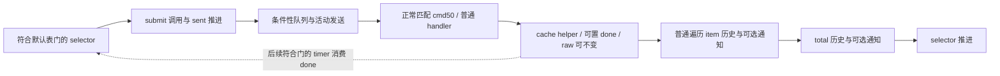

# P-10：默认 cmd50 请求到历史样本的事件与时间轴合同

**可独立使用阶段已闭合但接口未闭；待非作者合并复核。** 已能按普通 cmd50 响应接入 item/total 历史，保留样本计数轴；不能承诺固定采样率、MCU 测量年龄或 180 点对应的物理时长。本轮新增的是既有局部之间的事件合同和接入限制，新增 ROM 算法恢复为 0，不将重读旧字节计作新功能。

认领 P-10；独占 `.worktrees/batch-20261024-p/p10`，基线 `5bbc331`，只写本报告及同名 analysis。已读主树 reverse-design、管理顶部 P 及 P-10 行，不通读滚动历史。使用 [REA skill](C:/Users/cogic/.agents/skills/reverse-engineer-anything/SKILL.md) 的留存优先流程，未开/切共享 REA、未创建子代理、未执行目标、设备、网络、SIM/QEMU、回放、指令/输入模型或构建，未修改 ROM、生产、配置、分析器模型，未提交推送。其他工作者修改不动。

首次可得开始 `2026-10-24 14:23:59 UTC`，计划约 30 分钟有效工作；结束及实际墙钟见末节。Token 工具不可得，由父窗实测，不估造有效工时或 token。

## 继承结论与查重

先核旧完整父级：`application-rehost-0041-20261016.md` 已指向 round2；round2 的验收涉及界面/资源，round3 明记时间页“空功率图，不编造功率历史”。在主树和任务树按 `history/历史/采样/a0191746` 搜索这组父级文档及主树 `reverse/rehost` 的 Markdown/contract JSON，没有找到本题请求到真实样本的时间轴合同。此为这些输入的有界结果，不证明全库不存在。再核较晚专项及最终验收，继承如下，收缩为跨阶段连接，不重做已验算法或传输内部。

| 已有出处 | 已解释行为 | 本轮使用与局限 |
| --- | --- | --- |
| [dock/B01](dock-presence-polling-0041-20261023.md) | 五相 timer、默认表、selector、cache helper；B01 已纠正 off-phase 与 exhausted 分支区别 | 继承正常表和门控，未穷举运行期表/phase writer |
| [B03](poll-phase-review-b03-0041-20261023.md)、[B05](poll-phase-one-review-b05-0041-20261023.md) | cmd58 后调用 cache 读取与 phase0；cmd55 的 phase1/done/sent 顺序 | 直接继承，不能将启动 phase0 或单纯十进制 phase 循环当稳定模式 |
| [B19](uart-normal-parser-review-b19-0041-20261023.md)、[B21](queued-command-review-b21-0041-20261023.md) | 正常解析、cmd 匹配、两次 handler、固定优先槽、提交无成功回执 | 只接正常已匹配响应，不重做 CRC、重试、队列或 driver |
| [P-02](power-producer-p02-0041-20261024.md)、[P-R02](power-refresh-review-pr02-0041-20261024.md) | 普通 cmd50 raw→每项数值/状态→历史/通知→总量/历史/通知，限定接受 | raw 不变仍调历史；factory、单位/年龄、跨响应一致性未知 |
| [window-history](window-history-0041-20261023.md) | 364 B 结构、180 点环形写入、最大值与返回合同 | 不重做 helper 算法；原记录明确采样时间/绘图 reader 未闭 |

不存在用旧 pending 单独证明新题的情况。本轮不重验旧动态实验，不使用旧模拟通过推断实际时间。

## 本轮复核或纠正

原件沿 [CATALOG](../../../roms/CATALOG.md) 的 0041 `ap01-1.0.2_0041.bin`，6,769,704 B，SHA256 `972db4c136c7ed9e24a83c07c1a7fd62040ca018b08ca285216d26b1fee3c6b9`，RV32 little-endian，`file_offset = VA - 0x9ffff000`。沿身份，不另制整件哈希清单。

[本轮静态证据](../../analysis/history-sampling-p10-0041-20261024/static-evidence.json) 留 11 个必要窗口，共 766 B、234 条原留存指令行；ROM 字节与已有留存相同，另由半字前缀独立推 2/4 B 长度并核行边界。21 项断言 PASS；其数目不代表完整数据流证明或独立技术验收。普通/厂商指令的语义继承既有验收，没有执行或重建 ISA 模型。

| 来源 | 精确身份与 profile；不混贴新时间 |
| --- | --- |
| timer 原完整记录 | `dock-presence-polling.../retained-functions.json` 的 `0xa00a805a`，Evidence `ev_5fd69f489ac24670f4c858f79225e681a50079c28b088bb18e6f7b999de4fa59`，原 `whole-rom-private-20261023-066.json`；Ghidra 12.1.4、`RISCV:LE:32:ap01thead2`、digest `b6368dd18431e8113aa5026c713d41e648ab0f6ddd9421ff6c4a49e23b3cd2f3` |
| helper 原完整记录 | `uart-response-0041-20261023.json#/functions[1]`，`0xa0191652`，Evidence `ev_3a861f94ddb2b4481b6d96b4f46d593f35e2729ecb9022aa64949e92b607615c`，原 `whole-rom-uart-retry-20261023-001.json`；thead2、同上 b636 digest |
| timer/helper/selector 指令窗与表 | `dock-presence-polling.../instruction-windows.json`，旧静态解码 engine `[5,0,1280]`，厂商 unknown 行保留并沿 B01 模型解释；不是新的 Ghidra Evidence，不擅自给 selector 窗口分配 dossier/profile。表来自 `poll-initializers.json` 的 ROM `0xa0004634` 32 B |
| timer 注册和 cmd50/cmd58 切片 | 注册的完整来源见 `timer-registration-source.json`；cmd50/cmd58 来自 `buzzer-backlight-0041-20261023.json` 的 `0xa00a8582`，Evidence `ev_6f9f82e5daf0540a1c24a0b85daa2e394785391692765e5e3e100eb7b37ed94c`；Ghidra12.1.4、`RISCV:LE:32:ap01thead3`、digest `bcefdee5092076e55636e077b45523e203f4b870ae7b7ab547945ed1b8162279`，原 round3 initial bundle |

原函数/provider 有坏指令控制流局限；本题只用指定正常窗口与 P-R02 已验分支，不将完整 dispatcher 认证为正确。`static-evidence.json.observed_at_utc` 是本轮只读核对时间，不能替代上述原始 Evidence 的采集身份。

没有发现需要改旧业务结论的错误。纠正的是可能的跨文档误读：`period=10` 不是每十次 timer callback，`round_done=1` 也不是测量/整个响应通知已完成。

## 真正新增：可用的请求、样本和通知事件合同

### 默认表与调度机会

timer `0xa00a805a(timer)` 从 `timer+0x0c` 取 context；`context+0x190` 的 word 正常五相 0..4，USB 位于 3。注册参数 20 的毫秒单位沿用旧 LV timer 接口识别；本轮只核注册参数，未新认证库时基。正常五相且无调度延迟时，同一相位名义机会为 `5×20=100 ms`。该值描述 callback 机会，不描述 cmd50 周期或任何实测界限。

普通 USB 分支还要求 presence byte `context+0xc5 != 0` 且 `u8[0x62fcb50c]==1`；`0xa00a82be` 先调既有重试推进，返回后才读 controller.done。done 非零时依次：读取旧 phase/groups → 清 done → `phase=(u8)(phase+1)` → 每组 sent 清零 → 调 selector。不满足门控时，不能假设本轮发生任何 cmd50 请求或历史写入。stage0/2为发现边界、stage3为独立模式，不把它们套入普通采样率。

默认 `.data`：controller `C=0x62fc4b30`，groups `0x62fc4b20`，初始 phase0/count2/done0；组步长8，`commands@0,limit@4,period@5,sent@6`。

| 顺序 | commands | limit | period | 对 cmd50 的关系 |
| --- | --- | ---: | ---: | --- |
| 0 | `58` | 1 | 1 | 先于慢组；本轮尚未发送时优先选它 |
| 1 | `50 51 57 59` | 4 | 10 | phase%10==0 且本组 sent0 时才选50；后续按索引选其他项 |

`0xa0191746()` 逐组，首个 `phase%period==0 && sent<limit` 满足即选一项。off-phase 写 sent=limit；同 phase 耗尽组不重写 sent。提交 `{u8 cmd,u8 len=0,ptr=NULL}` 到 `0xa01951e2`，调用返回后重读/递增该组 sent，返回1；无项返回0。调用者不把其返回转换成投递保证。B21 已验 busy 时去重/固定四槽、满槽直接返回、非 FIFO；因此 selector 的 sent 增加只证明调用过 submit，不能据此增历史 cursor 或标“请求已测量”。没有新分配/释放义务；零长栈 descriptor 仅借给同步 submit，实际队列/活动区按旧合同复制。

若表保持默认、没有 phase 干预、没有额外 selector/生产入口且正常串行完成，一轮的候选顺序为先58，慢组 eligible 时再50→51→57→59；这些后续命令可由响应尾链接，不必各等一次 timer。该条件序列不保证每项实际到线、没有插队或已得到响应。

### round_done 与 phase 不是固定十轮时钟

helper `0xa0191652(dest,n,view)` 先清 transport.state，再按当时 phase 和 sent 查还有没有 eligible 项；没有则写 done1，有则保留旧 done，**不会在找到 eligible 项时主动清零**。然后比较/复制 raw，变化时可同步调用当前 handler `cmd+0x20`。这个完成检查早于普通 cmd50 历史和业务通知，不应在 done 被置位的一刻给样本盖章。

B03 的既有指令次序很关键：cmd58 调 helper 返回后才读 `u32[0x62fcb504]`，非零则 phase=0；该局部不清 done 或 sent，也不倒回重算 helper 的完成判定。于是“旧 phase 下判 done”与“新 phase 下 selector”可能相接。不能假设 done 的真值始终表示**当前** phase 全部完成，也不能以 58 cache 非零简单推断 cmd50 必定立即请求；仍须检查 slow sent、旧 done 和其他副作用。本轮没有执行状态模型或构造情形验证。

B05 已验 cmd55 初始化路径先 phase1、再 done0、再各 sent0、再 selector；该路径到达还受其原前奏控制，不是每次55无条件执行。即便完全排除这两种干预，timer 的 phase 为 byte 自增，并未模10：普通整十相位 0、10…250，然后回绕至0，250→0仅六次 advance。故“每十轮一次”也不是整个 byte 环的恒等式。未知的全部 writer/同步间接副作用继续保留。

### 正常匹配 cmd50 到 sample

沿 B19/B21：正常接收已通过既有 CRC、transport.state==2、响应 cmd 与活动 cmd 相等，复制响应副本后置 state3，当前非空 handler 接收 `(cmd,len,payload)`。这里只承接 handler 确实为普通 `0xa00a8582` 的情形；OTA/替换 handler 不据此采样。

cmd50 `0xa00a8b72..8b8c` 以 raw 缓存 `u32[0x62fcb2d0]` 为 destination、`(u8[0x62fcb01c]<<3)&0xf8` 为 n、栈 response view 调 helper，随后继续而不检查 helper 返回或比较结果。raw 相等只跳过 helper 的 copy/派生 `0x70`，不会跳过 cmd50 普通业务尾。

本题正常阶段条件为最终到达 `0xa00a8bac`，且 `T=u32[0x62fcb2cc]` 非空；factory 分支及其回到普通路径的全部门不在本题新增认证。T 空在 `8bb4` 去 selector，**本响应无本题 item/total 历史写入**。

| 写入点 | 调用条件/值与对象 | 与通知的顺序 |
| --- | --- | --- |
| `0xa00a9298/929c/92a0` | 普通 loop 实际遍历到一项 I，传 `I+0x3c` 与 `LHU(I+8)` 给 `0xa00a398c` | 在活动/数值/附加字段处理后，无 raw-change、active、P位4或历史返回值前置门；先 sample，后可选 item 同步通知，再推进 index |
| `0xa00a8c10/8c14/8c18/8c1a` | loop 退出后重新读 T，传 `T+0x0e` 与 `LHU(T+4)` | 不依赖本轮有无 P变化；本地总重算位0直接到此，count0也会到此。先前 item 回调已返回；总量仅在有item位4时重新求和，否则采旧总值，仍写历史 |

P-R02 已验 loop 每次边界重读 T/count，普通数值 helper 和 notifier 还各自重读全局，故“每响应每物理端口恰一条”“item/total同时刻且同代对象”均不能无条件成立。稳定对象/无回调替换且原 loop 正常返回时，可说每个被遍历 item 一次，total tail 一次；跨回调 borrowed 指针不得保留。数据接入回调中复制必要标量/历史视图到应用自有对象，不新增原程序原子性或存活保证。

历史 helper 每次调用均写 `samples[old_cursor]` 并推进 byte cursor（180归0），即便 value=0、重复或返回0。历史返回非零仅使对应 mask OR0x400；返回0且无其他变化可以不通知。反之其他字段变化可通知而不需要0x400。通知器之后清 mask 的所有权沿旧合同。**样本数、0x400事件数、所有通知数是三种计数**，不能用任一后两者倒推所有实际写入。

### 请求、完成和样本的可用关系

箭头为局部条件控制连接，不是每个 submit 必然到达 sample 的活性证明。cmd50 普通尾 `8c56/939c→8aae` 再调 selector；parser 返回后重读 handler 槽发0x24，普通0x24只在既有 OTA 门和 state0条件下尝试一个排队槽。0x24不是样本提交点，也不是 unconditional queue pop、历史完成或底座成功回执。

丢失/未匹配/尚未送达的响应不进入这段采样；请求仍等待、其他命令/优先槽、presence/USB门、handler替换、T空以及业务回调不返回均可使该段没有新样本。本题不补造超时样本、零值、last-value定时重采或 backlog catch-up；具体重试间隔沿旧传输合同，不在此重做。

## 名义时基、实际时轴及应用策略

ROM 历史视图为 `u16 samples[180],u16 maximum,u8 cursor,u8 maximum_slot`，没有采样时间戳字段。180 是槽容量；新对象初始零值也不是180次真实测量。可直接使用的原事实轴是**该对象收到的历史写入序号**；它只支持样本索引和先后关系。

不能将20ms直接作一个点，不能将100ms USB机会作一个点，也不能将 period10直接换成固定1秒/点或180秒窗口。即使为了说明而把所有排队/响应都理想化，仍有 byte回绕、cmd58phase干预、完成消费次序等条件；实际响应延时、timer迟到、callback耗时、MCU采样瞬间和跨对象一致性没有运行证据。没有可证的最短响应间隔、固定采样率或有限最大断样时长，因而也没有能据此给出的信号带宽/Nyquist保证。

下面是**重建程序可选新策略，不是 ROM 事实**：

- 若只消费现有 ring，横轴标“样本”并保留 cursor 环形顺序，避免宣称物理秒数。cursor差按模180只能给有限信息，整圈或更多写入会混叠；notification计数也不能补齐静默写入。
- 若实现新的数据入口，在明确的普通 cmd50 接收/应用写入点记录单调时钟、响应序号、对象代际；每个被遍历 item 及 total 的写入可关联同一入口序号，同时保留它们各自采样/回调的顺序差。只在通知回调加时间戳会漏掉无通知的历史写入。
- 以该新时标绘制不规则间隔或显式缺口。接收时间只表示应用观察时刻，不能称底座测量时刻；不要伪造固定间隔、把缺失响应补成0，或凭重复值认作没有新样本。应用若选择插值/重采样须另标设计选择。

## 未闭精确边与合并复核包

[机器合同](../../analysis/history-sampling-p10-0041-20261024/interface.json) 可直接供新接入层使用；物理时间接口仍未闭。未知：实际 timer/响应间隔、MCU测量时间/年龄与wire单位；所有phase/table/handler writer、跨响应对象代际保证；真实绘图 reader 的环形顺序与全部订阅/退出；原程序正常请求的最终投递活性。未将 public timer/poll/driver、MCU或其他命令状态机纳入。

真实后继 seed 为 **`0xa00a8c1a→0xa00a398c` 写 `T+0x0e` ring，及 `0xa00a92a0` 写 `I+0x3c` ring**：从该精确布局定位一个真实绘图读取者，回答 cursor顺序/0x400消费和复制寿命。先核较晚完整父级/既有消费者，查重后预估20–30分钟；若已有则继承收缩，不自动开题。现有 `0xa00ad07e` theme total callback 已有普通数值消费者合同，不能仅因名字/theme归属便宣称它就是 ring reader；本轮未新增该消费者窗口。

供新非作者一次合并核：①默认表/selector off-phase与exhausted区别及sent不保证投递；②helper旧phase判done、58后读清phase、55复位与timer clear/increment/reset/select的原次序；③普通cmd50 raw相等不挡历史、T空与正常遍历/total tail门；④sample先于通知且通知可静默、180无时间字段；⑤新时间戳策略独立标为设计选择，实际固定率保持未知。必要继承仅核B01/B03/B05/B19/B21/P-R02/window-history接缝，不重跑旧算法或回放。

实际检查仅运行本轮 [verify_static.py](../../analysis/history-sampling-p10-0041-20261024/verify_static.py)，只读766B ROM窗及32B默认表、已有JSON；21断言通过。没有独立非作者验收或运行行为证明。结束、交付引用/JSON/格式/diff结果追加于下。

结束 `2026-10-24 14:32:30 UTC`，墙钟约 512 秒，按证据收敛提前交付；无主动等待/任务中断，工具读取和核验计入墙钟，未另测有效工时。Token由父窗统计。两份业务/证据JSON与交付JSON可解析、13个本地引用（必要继承回退主树）可定位、UTF-8/尾换行/无尾空格、独占路径状态与diff检查PASS；详见 [delivery-checks.json](../../analysis/history-sampling-p10-0041-20261024/delivery-checks.json)。未提交推送，作者交付后停止。
