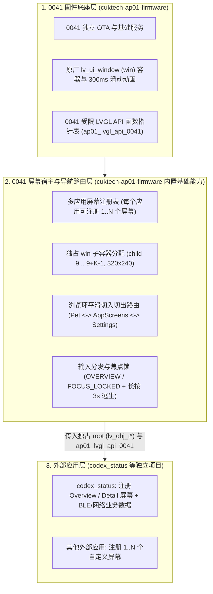
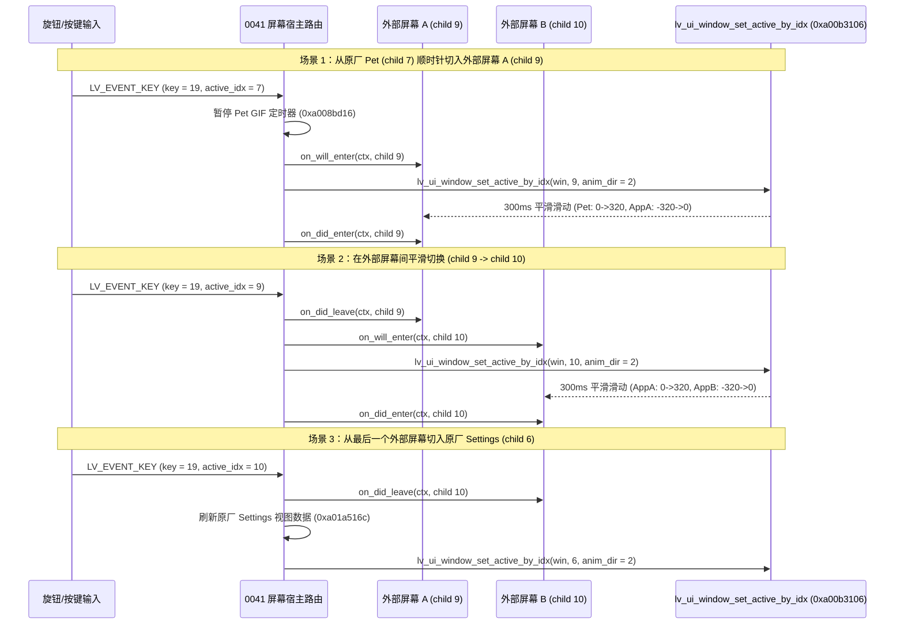
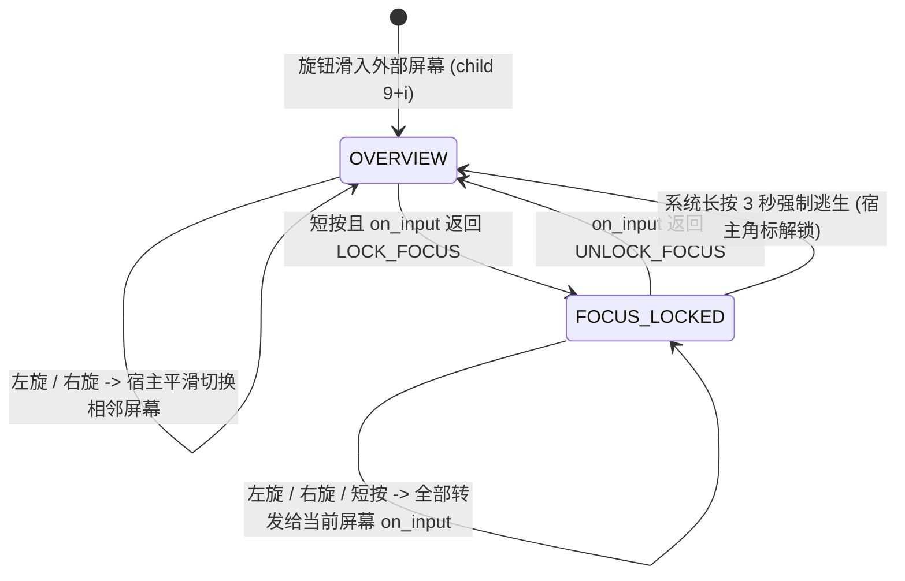

# AP01 0041 多应用多屏幕宿主与平滑切换架构规划

本文档记录 `cuktech-ap01-firmware` 与外部业务项目（如 `codex_status`）的职责分工评估结论，以及在 **0041 (`1.0.2_0041`)** 固件基线上构建通用多应用、多屏幕宿主（Multi-App Screen Host）与平滑切入切出机制的完整规划。

---

## 1. 版本定位与仓库职责边界

### 1.1 0031 与 0041 的功能划分

| 固件基线 | 定位与职责范围 | 外部 App 支持 |
| --- | --- | --- |
| **0031 (`1.0.2_0031`)** | **首次跳板与最小维护基线**：仅提供最基础的独立整包 OTA（[`ota_0031.c`](../../../tooling/firmware-modules/ota_0031.c)）与网络诊断控制台（[`diagnostic_console_0031.c`](../../../tooling/firmware-modules/diagnostic_console_0031.c)）。 | **不提供额外外部 App 宿主或多屏幕支持**（历史同步 APX1 仅保留为早期受限调用记录）。 |
| **0041 (`1.0.2_0041`)** | **主力运行与外部应用宿主基线**：提供基础 OTA（[`ota_0041.c`](../../../tooling/firmware-modules/ota_0041.c)）、多应用加载、多屏幕注册宿主、顶层 `win` 平滑切入切出路由、焦点锁管理以及受限 LVGL API 表。 | **完整支持**：每个外部应用可注册 `1..N` 个屏幕并纳入主界面浏览环。 |

### 1.2 `cuktech-ap01-firmware` 与 `codex_status` 的分工评估

在原有实现中，`codex_status` 同时承担了业务状态展现（GATT/广播数据接收、状态卡片布局）与底层固件侵入（直接绑死特定 ROM 虚拟形象页索引、直接替换 `win` 事件回调、硬编码原厂函数地址并独占屏幕槽位）。这种耦合导致：
1. 底座能力被单一业务应用独占，无法同时挂载第二个外部应用或让单个应用注册多个屏幕；
2. 页面切换与原厂主界面滑动环的衔接逻辑散落在业务代码内，难以统一维护动画与按键退回语义。

重构后的三层职责边界如下：



- **`cuktech-ap01-firmware`（平台与底座）**：
  - 维护 `0031` 最小 OTA + 控制台，以及 `0041` OTA + **多应用屏幕宿主（Screen Host）**。
  - 将“屏幕注册、`win` 子容器生命周期、平滑切入切出动画、主界面编码器导航环拼接、焦点锁与长按 3 秒强制逃生、受限 LVGL API 表暴露”收敛为 `0041` 的内置基础功能。
- **`codex_status`（纯外部业务应用）**：
  - 不再关心 `win` 内部偏移、相邻页面索引或原厂按键回调挂钩。
  - 在应用初始化时调用底座 `register_screen` 注册一个或多个屏幕（例如“状态总览屏”、“会话详情屏”），在各自分配的 `lv_obj_t *root` 子容器内通过底座暴露的受限 LVGL API 表创建与更新控件。

---

## 2. 已确认的核心架构决策

1. **浏览环拼接策略（方案 A：共存追加，保留原厂虚拟形象页）**
   - 完整保留 `0041` 原厂虚拟形象（`Pet` / 猫 GIF，子对象索引 `7`）及其动画资源。
   - 所有外部应用注册的屏幕按（应用挂载顺序，应用内注册顺序）依次插入在 `Pet`（索引 `7`）与 `Settings`（索引 `6`）之间：
     $$\dots \leftrightarrow \text{Weather (5)} \leftrightarrow \text{Pet (7)} \leftrightarrow \text{App}_1.\text{Screen}_1 \leftrightarrow \dots \leftrightarrow \text{App}_M.\text{Screen}_K \leftrightarrow \text{Settings (6)} \leftrightarrow \dots$$
2. **容器模型（每个注册屏幕独占一个 `win` 子对象）**
   - 在顶层 `win` 滑动容器下，原厂固定创建 `0..8` 共 9 个子对象。
   - 宿主为每个外部注册屏幕创建一个独立的 `lv_obj_t *` 子对象（索引为 `9, 10, ..., 9 + N - 1`），固定尺寸 `320×240`、无圆角、无边框、内边距为 `0`，初始位置设在屏幕右侧待命区 `x = 320` (`0x140`)。
   - 优势：页面切入切出时直接由原厂滑动器改变新旧两个子容器的 `x` 坐标，**零控件销毁/重建开销**，且在 300 ms 滑动过程中新旧两屏内容同时平滑移动。
3. **渲染接口（外部应用直接操作底座暴露的受限 LVGL API 表）**
   - 底座提供版本化的只读函数指针表 `ap01_lvgl_api_0041`，封装经 `0041` 静态核实的 LVGL 控件创建、样式设置与属性更新接口。
   - 外部应用仅允许以自身屏幕的 `root`（或其下属子控件）作为 `parent` 创建控件，严禁修改 `root` 自身的几何坐标（`x/y/size` 由 `win` 滑动器托管）或越界访问 `lv_obj_get_parent(root)`。

---

## 3. 0041 原厂滑动容器与平滑切入切出原理

### 3.1 0041 用户 UI 滑动容器 (`lv_power_ui/lv_ui_window.c`) 事实

`0041` 固件内含两套窗口滑动组件：`factory_ui/lv_window_slider.c`（`0xa00a4116..0xa00a4aa0`，供工厂测试界面使用）与 **`lv_power_ui/lv_ui_window.c`**（`0xa00b2f6c..0xa00b3250`，字符串位于 `0xa05602fc`，供日常主界面 `lv_win_ui_theme_create` 使用）。外部应用屏幕宿主对接的是日常主界面的 `lv_ui_window`：

| 0041 函数 / 字段 | 地址 / 偏移 | 作用与行为 |
| --- | --- | --- |
| `lv_win_ui_theme_create` | `0xa005cd20` | 创建主界面顶层 `win`（寄存器 `s4`）及其下属 9 个原厂子页面（索引 `0..8`）。 |
| `lv_ui_window_create` | `0xa00b2f6c` | 创建顶层 `win` 容器对象。 |
| `lv_ui_window_get_active_idx` | `0xa00b2ff4` | 读取 `*(uint32_t *)(win + 0x34)`，返回当前活动子页面索引。 |
| `lv_ui_window_get_child_by_idx` | `0xa00b3036` | 调用 `lv_obj_get_child(win, idx)`（`0xa00dcee4`）获取第 `idx` 个子容器。 |
| `anim_left_2_right_move_cb` | `0xa00b3080` | 300 ms 动画回调（`anim_dir = 2`）：在 $v \in [0, 320]$ 内将旧子页面 `*(win + 0x38)` 移至 $x = v$，新子页面 `*(win + 0x34)` 移至 $x = v - 320$。 |
| `anim_right_2_left_move_cb` | `0xa00b30c0` | 300 ms 动画回调（`anim_dir = 1`）：在 $v \in [0, 320]$ 内将旧子页面 `*(win + 0x38)` 移至 $x = -v$，新子页面 `*(win + 0x34)` 移至 $x = 320 - v$。 |
| `lv_ui_window_set_active_by_idx` | `0xa00b3106` | **核心切页函数**：停止未完成动画（`0xa01b2eb4(0, 0)`），复位上次残留子页面到 `x = 320`，更新 `*(win + 0x38) = old_idx`、`*(win + 0x34) = target_idx`、`*(uint8_t *)(win + 0x4c) = 0`，并按 `anim_dir`（`0` 瞬切、`1` 右向左滑、`2` 左向右滑）启动 300 ms `lv_anim_t`（`0xa008bf6e`）。 |
| `lv_ui_window_anim_ready_cb` | `0xa00ab628` | 滑动动画结束回调：置 `*(uint8_t *)(win + 0x4c) = 1`；若目标页为 `7`（`Pet`），恢复猫 GIF 定时器（`0xa008bd70`）。 |
| `j_win_ui_theme_event_custom_handler` | `0xa00afc88` | 主界面 `LV_EVENT_KEY`（事件码 `0x11`）处理函数，处理 `key = 19`（`0x13`）、`key = 20`（`0x14`）及按键确认事件。 |

### 3.2 `win` 对象关键字段与子对象索引布局

`win` 对象关键状态字段：
- `win + 0x34` (`uint32_t`)：当前活动子容器索引 (`active_idx`)。
- `win + 0x38` (`uint32_t`)：上一个活动子容器索引 (`prev_idx`)。
- `win + 0x4c` (`uint8_t`)：滑动动画空闲标志（`0` = 动画进行中，`1` = 动画已完成；`1000 ms` 周期定时器 `0xa00af262` 在 `+0x4c == 0` 时跳过重绘以保证滑动流畅）。
- `win + 0x4d` (`uint8_t`)：二级详情页标志（`0` = 顶层主界面浏览环，`1` = 已进入某页的二级子页面）。

`win` 子对象（`lv_obj_get_child(win, idx)`）布局：

| `win` 子对象索引 `idx` | 归属 | 页面名称 | Tag (`*(*(child + 0x10))`) | 备注 |
| :---: | --- | --- | :---: | --- |
| `0` | 原厂 | Power（总功率页） | `1` (`0x01`) | 含端口状态与功率详情入口 |
| `1` | 原厂 | C1（单口详情页） | `49` (`0x31`) | 仅在 C1 在线且单口显示开启时进入浏览环 |
| `2` | 原厂 | C2（单口详情页） | `50` (`0x32`) | 仅在 C2 在线且单口显示开启时进入浏览环 |
| `3` | 原厂 | Time（时钟页） | `2` (`0x02`) | 屏保/时间显示 |
| `4` | 原厂 | Date（日期页） | `3` (`0x03`) | 屏保/日期显示 |
| `5` | 原厂 | Weather（天气页） | `4` (`0x04`) | 屏保/天气显示 |
| `6` | 原厂 | Settings（设置页） | `9` (`0x09`) | 二级设置菜单入口 |
| `7` | 原厂 | Pet（虚拟形象/猫 GIF 页） | `10` (`0x0a`) | 完整保留，离开时暂停 GIF 定时器，进入时恢复 |
| `8` | 原厂 | Mijia（米家状态页） | `35` (`0x23`) | 按配网/状态条件显示 |
| `9 .. 9+N-1` | **外部应用宿主** | **注册屏幕 `0 .. N-1`** | `0x80 + screen_slot` | 每个注册屏幕独占一个 `320×240` 子对象，初始 `x = 320` |

### 3.3 接入点与平滑切入切出流程

宿主仅需在 `lv_win_ui_theme_create`（`0xa005cd20`）尾部接入两个轻量级挂钩点：

1. **子容器创建挂钩（`0xa005d0b6`）**：
   - 在原厂 9 个子页面全部执行完 `lv_obj_set_x(child, 320)` 后、`0xa005d0b6` 调用 `lv_obj_get_child_cnt(win)`（`0xa00dd144`）前介入。
   - 宿主遍历已注册的 $N$ 个外部屏幕，依次调用 `lv_obj_create(win)`（`0xa00d91c6`）创建子对象 `9 .. 9+N-1`，分配 8 字节标签描述块挂载到 `*(child + 0x10)`，设置尺寸 `320×240`、背景透明/純黑、无边框无内边距，并调用 `lv_obj_set_x(child, 320)`（`0xa00d8c12`）置于右侧待命位置，随后调用各屏幕的 `on_create(screen_ctx, child, &lvgl_api)`。
2. **按键与旋钮路由挂钩（`0xa005d102` 附近 / `0xa00afc88` 包装）**：
   - 包装注册在 `win` 上的 `LV_EVENT_KEY`（`0x11`）回调 `0xa00afc88`。
   - 当 `*(uint8_t *)(win + 0x4d) == 0`（处于顶层主浏览环）且屏幕已唤醒时，拦截 `Pet`（索引 `7`）、外部注册屏幕（索引 `9 .. 9+N-1`）与 `Settings`（索引 `6`）之间的切页事件：



- **正向旋转（`key = 19`，使用 `anim_dir = 2`，与原厂 `0xa00afc88` 主环方向一致）**：
  - 当前在 `Pet`（`7`）：查找第一个 `is_visible() != 0` 的外部注册屏幕 `target = 9 + k`；若存在，暂停 `Pet` GIF 定时器（`0xa008bd16`），触发目标屏 `on_will_enter`，调用 `lv_ui_window_set_active_by_idx(win, target, 2)`；若所有外部屏幕均不可见，则直接走原厂逻辑切往 `Settings`（`6`）。
  - 当前在外部屏幕 `9 + i`：查找下一个 `is_visible() != 0` 的外部屏幕 `9 + k`（$k > i$）；若找到，调用 `lv_ui_window_set_active_by_idx(win, 9 + k, 2)`；若已是最后一个可见外部屏幕，则调用 `0xa01a516c` 刷新原厂设置页数据，并调用 `lv_ui_window_set_active_by_idx(win, 6, 2)` 平滑切入 `Settings`（`6`）。
- **反向旋转（`key = 20`，使用 `anim_dir = 1`，与原厂 `0xa00afc88` 反向环一致）**：
  - 当前在 `Settings`（`6`）：查找最后一个 `is_visible() != 0` 的外部注册屏幕 `target = 9 + k`；若存在，触发目标屏 `on_will_enter`，调用 `lv_ui_window_set_active_by_idx(win, target, 1)`；若均不可见，走原厂逻辑切回 `Pet`（`7`）。
  - 当前在外部屏幕 `9 + i`：查找前一个 `is_visible() != 0` 的外部屏幕 `9 + k`（$k < i$）；若找到，调用 `lv_ui_window_set_active_by_idx(win, 9 + k, 1)`；若已是第一个可见外部屏幕，则调用 `lv_ui_window_set_active_by_idx(win, 7, 1)` 平滑切回 `Pet`（`7`，动画结束回调 `0xa00ab628` 会自动恢复猫 GIF 定时器）。

> [!NOTE]
> `0041` 的 `1000 ms` 周期定时器 `0xa00af262` 通过显式索引 `0, 3, 4, 5, 6, 7, 8` 访问原厂子页面，不会越界访问 `idx >= 9` 的子对象；当 `active_idx >= 9` 时，原厂后台时间/天气数据仍正常维护，宿主可在同一 `1000 ms` 节拍向当前活动的外部屏幕派发 `on_tick`。

---

## 4. 外部应用多屏幕注册与交互状态机规范

### 4.1 焦点模式与防卡死逃生机制

外部屏幕处于活动状态（`active_idx == 9 + i`）时，支持两种焦点状态：



1. **浏览态 (`AP01_SCREEN_MODE_OVERVIEW`)**：
   - 旋钮左右旋转由宿主直接消费，用于平滑切入上一张/下一张屏幕。
   - 短按事件转发给当前屏幕的 `on_input(ctx, AP01_INPUT_PRESS_SHORT)`：
     - 若屏幕仅做轻量刷新（如切换卡片视图），返回 `AP01_INPUT_STAY_OVERVIEW`；
     - 若屏幕需要内部滚动或菜单选择，返回 `AP01_INPUT_LOCK_FOCUS`，宿主将其切入锁定态。
2. **焦点锁定态 (`AP01_SCREEN_MODE_FOCUS_LOCKED`)**：
   - 旋钮左旋（`AP01_INPUT_ENC_LEFT`）、右旋（`AP01_INPUT_ENC_RIGHT`）和短按（`AP01_INPUT_PRESS_SHORT`）全部转发给当前屏幕的 `on_input`。
   - 当用户完成内部操作时，`on_input` 返回 `AP01_INPUT_UNLOCK_FOCUS`，恢复浏览态。
   - **长按 3 秒平台级逃生**：无论外部应用代码处于何种状态，只要检测到长按达到 3 秒，宿主强制解除 `FOCUS_LOCKED` 并通知 `on_input(ctx, AP01_INPUT_ESCAPE_FORCE)`，保证外部应用永远无法锁死设备的旋钮切页功能。

### 4.2 多屏幕注册与生命周期接口草案 (`app_screen_0041.h`)

```c
#ifndef AP01_APP_SCREEN_0041_H
#define AP01_APP_SCREEN_0041_H

#include <stdint.h>
#include <stddef.h>

#define AP01_SCREEN_ABI_VERSION_0041 UINT32_C(1)
#define AP01_MAX_REGISTERED_SCREENS  UINT32_C(8)

typedef struct lv_obj_t lv_obj_t;
typedef struct lv_font_t lv_font_t;
typedef struct ap01_lvgl_api_0041 ap01_lvgl_api_0041;

typedef enum ap01_input_event_0041 {
    AP01_INPUT_ENC_LEFT     = 1,
    AP01_INPUT_ENC_RIGHT    = 2,
    AP01_INPUT_PRESS_SHORT  = 3,
    AP01_INPUT_PRESS_LONG   = 4,
    AP01_INPUT_ESCAPE_FORCE = 5
} ap01_input_event_0041;

typedef enum ap01_input_result_0041 {
    AP01_INPUT_STAY_OVERVIEW = 0,
    AP01_INPUT_LOCK_FOCUS    = 1,
    AP01_INPUT_UNLOCK_FOCUS  = 2
} ap01_input_result_0041;

typedef struct ap01_screen_desc_0041 {
    uint32_t struct_bytes;
    const char *app_id;       /* 例如 "codex_status" */
    const char *screen_id;    /* 例如 "overview"、"session_detail" */
    uint16_t priority;        /* 排序权重，默认 100 */
    uint16_t flags;           /* 预留标志位，默认 0 */
    void *screen_ctx;         /* 外部应用自有上下文 */

    /* 返回 1 表示参与主浏览环，返回 0 表示在切页时动态跳过 */
    int (*is_visible)(void *screen_ctx);

    /* 在 win 创建阶段调用一次，root 即该屏幕独占的 320x240 win 子对象 */
    int (*on_create)(void *screen_ctx, lv_obj_t *root, const ap01_lvgl_api_0041 *lvgl);

    /* 300ms 切入动画启动前调用，可用于刷新即将显示的文本/状态 */
    void (*on_will_enter)(void *screen_ctx, lv_obj_t *root);

    /* 切入完成时调用 */
    void (*on_did_enter)(void *screen_ctx, lv_obj_t *root);

    /* 切出到其他屏幕时调用 */
    void (*on_did_leave)(void *screen_ctx, lv_obj_t *root);

    /* 处于活动页时的按键/旋钮输入回调 */
    ap01_input_result_0041 (*on_input)(void *screen_ctx, lv_obj_t *root,
                                       ap01_input_event_0041 event);

    /* 处于活动页且无滑动动画时的 1000ms 周期节拍回调 */
    void (*on_tick)(void *screen_ctx, lv_obj_t *root, uint32_t now_ms);
} ap01_screen_desc_0041;

typedef struct ap01_host_api_0041 {
    uint32_t abi_version;
    uint32_t struct_bytes;
    const ap01_lvgl_api_0041 *lvgl;

    /* 注册一个屏幕，成功返回分配的 slot_id (0..AP01_MAX_REGISTERED_SCREENS-1)，失败返回负值 */
    int (*register_screen)(const ap01_screen_desc_0041 *desc);

    /* 请求平滑切换到本应用已注册的某个 slot_id（仅在顶层浏览态有效） */
    int (*request_switch_to)(int slot_id, uint32_t anim_dir);
} ap01_host_api_0041;

#endif
```

---

## 5. 0041 受限 LVGL API 表 (`ap01_lvgl_api_0041`)

底座向外部应用暴露的 `ap01_lvgl_api_0041` 仅包含经 `0041` 原件（SHA256 `972db4c136c7ed9e24a83c07c1a7fd62040ca018b08ca285216d26b1fee3c6b9`）核实的 LVGL 与基础辅助符号：

| 字段名称 | 0041 ROM 地址 | 函数签名与用途说明 |
| --- | :---: | --- |
| `obj_create` | `0xa00d91c6` | `lv_obj_t *(*)(lv_obj_t *parent)` — 在指定父容器内创建基础对象 |
| `obj_del` | `0xa00d7806` | `void (*)(lv_obj_t *obj)` — 删除子控件（禁止对 `root` 本身调用） |
| `obj_set_size` | `0xa00d8e96` | `void (*)(lv_obj_t *obj, int16_t w, int16_t h)` — 设置子控件宽高 |
| `obj_set_x` | `0xa00d8c12` | `void (*)(lv_obj_t *obj, int16_t x)` — 设置子控件 X 坐标 |
| `obj_align` | `0xa00d92ec` | `void (*)(lv_obj_t *obj, uint8_t align, int16_t x_ofs, int16_t y_ofs)` — 对齐子控件 |
| `obj_align_to` | `0xa00dbb68` | `void (*)(lv_obj_t *obj, const lv_obj_t *base, uint8_t align, int16_t x_ofs, int16_t y_ofs)` — 相对对齐 |
| `obj_center` | `0xa00dc582` | `void (*)(lv_obj_t *obj)` — 居中子控件 |
| `obj_add_flag` | `0xa00d8f7c` | `void (*)(lv_obj_t *obj, uint32_t flag)` — 添加对象标志（如 `LV_OBJ_FLAG_HIDDEN = 1`） |
| `obj_remove_flag` | `0xa00d9044` | `void (*)(lv_obj_t *obj, uint32_t flag)` — 清除对象标志 |
| `obj_set_style_bg_color` | `0xa00dfb70` | `void (*)(lv_obj_t *obj, uint32_t color, uint32_t selector)` — 设置背景颜色 |
| `obj_set_style_radius` | `0xa019d5b8` | `void (*)(lv_obj_t *obj, int16_t radius, uint32_t selector)` — 设置圆角半径 |
| `obj_set_style_border_width` | `0xa00dfbca` | `void (*)(lv_obj_t *obj, int16_t width, uint32_t selector)` — 设置边框宽度 |
| `obj_set_style_pad_all` | `0xa00a5c0c` | `void (*)(lv_obj_t *obj, int16_t pad, uint32_t selector)` — 设置四周边距 |
| `label_create` | `0xa009090e` | `lv_obj_t *(*)(lv_obj_t *parent)` — 创建文本标签 |
| `label_set_text` | `0xa0091b3a` | `void (*)(lv_obj_t *label, const char *text)` — 设置静态/动态字符串 |
| `label_set_text_fmt` | `0xa0091ee4` | `void (*)(lv_obj_t *label, const char *fmt, ...)` — 格式化设置标签文本 |
| `set_text_font` | `0xa019d0ae` | `void (*)(lv_obj_t *obj, const lv_font_t *font, uint32_t selector)` — 设置字体 |
| `set_text_color` | `0xa019d0e6` | `void (*)(lv_obj_t *obj, uint32_t color, uint32_t selector)` — 设置文本颜色 |
| `image_create` | `0xa00ed0a8` | `lv_obj_t *(*)(lv_obj_t *parent)` — 创建图像控件 |
| `image_set_src` | `0xa00ed560` | `void (*)(lv_obj_t *img, const void *src)` — 设置图像数据源 |
| `gif_create` | `0xa019cf0a` | `lv_obj_t *(*)(lv_obj_t *parent)` — 创建 GIF 控件 |
| `gif_set_src` | `0xa00ed7f4` | `void (*)(lv_obj_t *gif, const void *src)` — 设置 GIF 数据源 |

### 使用约束
1. **线程安全**：所有 `ap01_lvgl_api_0041` 调用必须在 LVGL UI 线程上下文（即 `on_create`、`on_will_enter`、`on_did_enter`、`on_did_leave`、`on_input`、`on_tick` 回调内）执行。若外部应用存在后台网络或 BLE 接收线程，后台线程只能更新应用私有状态缓存并置脏标记，在 `on_tick` 或 `on_will_enter` 中合入 LVGL 控件。
2. **容器隔离**：外部应用只能向自己屏幕的 `root` 容器内添加子控件，不得修改 `root` 的 `x`、`y`、宽高或父子层级，以确保 `lv_ui_window_set_active_by_idx` 的 300 ms 滑动动画始终可预测。

---

## 6. `codex_status` 接入与演进路径

在 `0041` 具备上述多屏幕宿主能力后，`codex_status` 的接入方式演进如下：
1. **移除私有 UI 挂钩**：从 `codex_status` 仓库中移除直接修改 `win` 事件处理函数、直接覆盖 `Pet` 槽位以及硬编码相邻页面切换的代码。
2. **按屏幕粒度注册**：
   - `codex_status` 在初始化入口通过 `host_api->register_screen()` 注册 `1..N` 个屏幕描述符（例如 `codex_status/overview` 与 `codex_status/detail`）。
   - 在 `on_create` 中使用 `ap01_lvgl_api_0041` 在各自独占的 `root` (`lv_obj_t *`) 下构建标签、进度条或状态指示控件。
   - 在 `on_will_enter` 与 `on_tick` 中根据最新接收到的 Codex 会话状态调用 `lvgl->label_set_text` / `lvgl->label_set_text_fmt` 刷新显示。
3. **平滑切入切出与多应用共存**：
   - 当用户转动旋钮经过 `Pet`（索引 `7`）时，屏幕以原厂 300 ms 水平滑动动画平滑切入 `codex_status/overview`（索引 `9`），继续转动平滑切入 `codex_status/detail`（索引 `10`）及其他外部应用屏幕，最后平滑切入原厂 `Settings`（索引 `6`）。
   - 若 `codex_status` 尚未收到主机连接且配置了自动隐藏，`is_visible()` 返回 `0`，宿主在切页时自动跳过该屏幕，不产生空白黑屏页。
